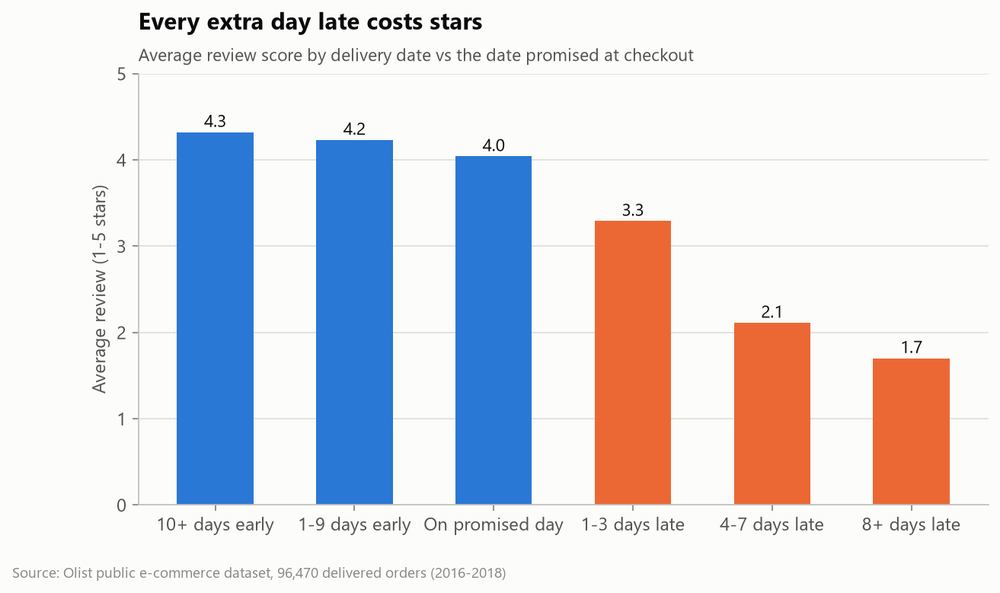
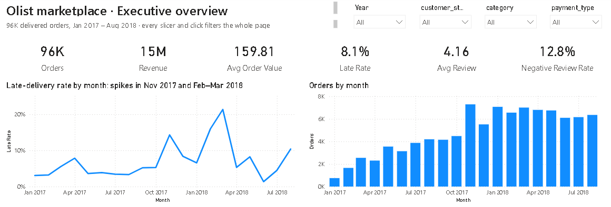
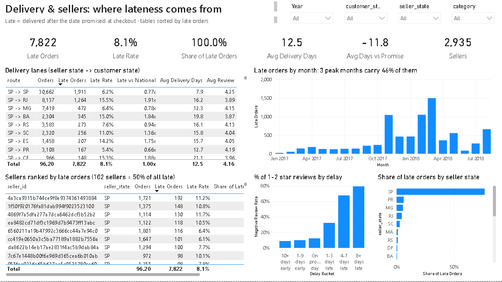
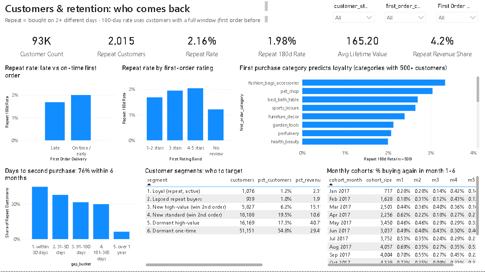
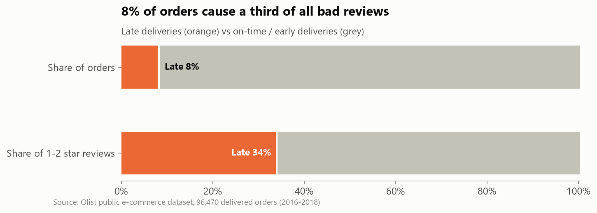
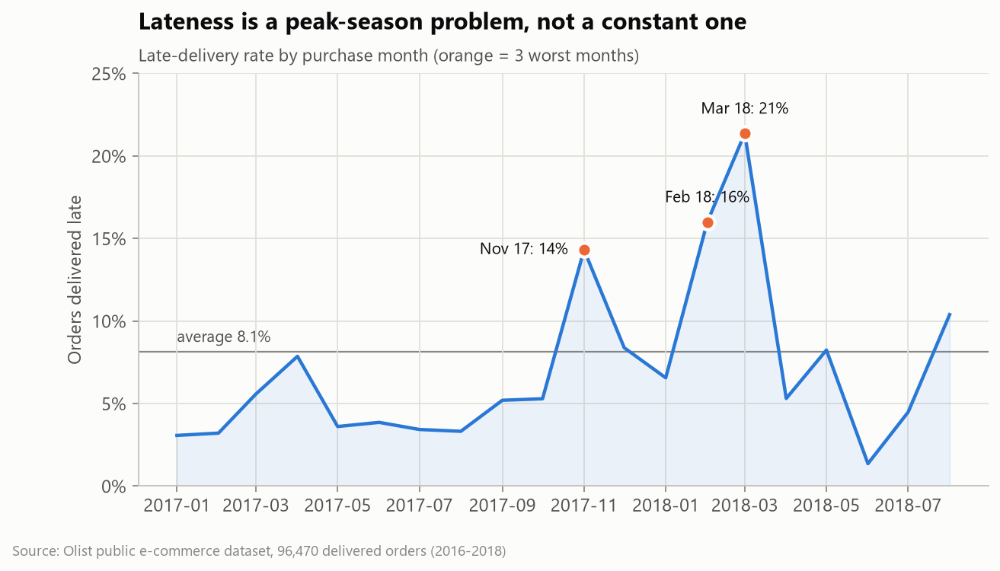
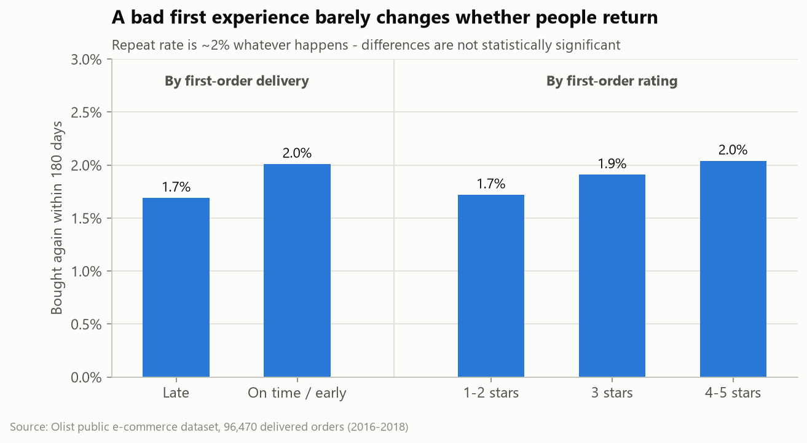

# Why don't marketplace customers come back?
### Delivery performance, ratings and retention at Olist (96K orders · SQL + Python)

> **Executive summary**
> * **Problem:** Olist, a Brazilian e-commerce marketplace, keeps only **2.2%** of its customers. Leadership believed late deliveries were driving them away.
> * **Finding:** That's **half right**. Late orders are 8% of volume but cause **34% of all 1-2 star reviews**. Yet a late or 1-star first order does **not** change whether a customer returns (1.7% vs 2.0%, p = 0.17). Loyalty isn't being lost; it is never being built.
> * **Recommendation:** Two programmes. **(1) Operations:** lateness is concentrated in 3 peak months (46% of late orders), 102 sellers (50%) and long-haul lanes (2x late), so fix those first. **(2) CRM:** a second-order programme in the 7-120 day window, tested against a holdout.
> * **Impact:** the peak-season plan alone removes up to ~31% of late orders (~1,100 fewer bad reviews); +1 pp repeat rate ≈ **R$120K / year**.

**Deliverables:** [Power BI dashboard](#power-bi-dashboard) · [Analysis notebook](notebooks/analysis.ipynb) · [HTML dashboard](dashboard/index.html) · [Recommendation deck (.pptx)](reports/Olist_Recommendations_Deck.pptx) · [SQL](sql/)



## Power BI dashboard

Three interactive pages (51 visuals, 22 DAX measures) on a star-schema model: `fact_orders` (96K rows) ← `dim_customers` (93K rows) plus three summary tables. Every slicer and click cross-filters the page.

| Page | What it answers |
|---|---|
| **Executive Overview** | 6 KPIs, late rate and orders by month, rating by delay, late rate by state, revenue by category |
| **Delivery & Sellers** | Late-order KPIs, lane table (late rate vs national), seller ranking, negative reviews by delay |
| **Customers & Retention** | Repeat-rate KPIs, repeat by first-order experience and category, days to 2nd purchase, segments, monthly cohorts |





**Open it:** run `python src/run_sql.py`, open `powerbi/Olist.pbip` in Power BI Desktop, set the `DataFolder` parameter (Transform data → Edit parameters) to your `data/processed/` path, then **Home → Refresh**. The project is in Power BI's text-based PBIP format (TMDL model + report definition) and is generated by [`src/build_powerbi.py`](src/build_powerbi.py), so every measure and visual is version-controlled.

---

## 1. Business questions

| # | Question | Answer |
|---|---|---|
| 1 | Does late delivery hurt satisfaction? | **Yes, strongly.** 54% of late orders get 1-2 stars vs 9% on time (p < 0.001) |
| 2 | Where does lateness come from? | **Concentrated:** 3 months, 3.5% of sellers, São Paulo → long-haul lanes |
| 3 | Does a bad experience stop repeat purchases? | **No.** Repeat is ~2% regardless (p = 0.17); a model on all first-order data scores AUC 0.54 |
| 4 | What does predict repeat buying? | **First-purchase category** (3.3% vs 1.1%, p < 0.001) and **timing**: 76% return within 6 months |
| 5 | What should the business do? | 5 actions ranked by impact, each with an owner and success metric ([below](#5-recommendations)) |

## 2. Data

[Olist Brazilian E-Commerce Public Dataset](https://github.com/olist/work-at-olist-data) (also on [Kaggle](https://www.kaggle.com/datasets/olistbr/brazilian-ecommerce)), CC BY-NC-SA 4.0. It has 99,441 orders from Sep 2016 to Oct 2018 across 8 related tables:

```
customers ─┐                    ┌─ order_items ── products ── category_translation
           └── orders (hub) ────┼─ order_payments            └─ sellers
                                └─ order_reviews
```

**Data-quality decisions** (from [`sql/02_data_quality.sql`](sql/02_data_quality.sql)):

| Issue | Handling |
|---|---|
| `customer_id` changes on every order | Used `customer_unique_id` as the real person; otherwise the repeat rate would show as 0% |
| 890 "repeat" orders placed the same day (one basket split by seller) | A repeat customer must buy on **2+ different days** |
| 547 orders with 2+ reviews, 1,275 multi-seller orders | Scores averaged; multi-seller orders excluded from seller metrics only |
| Retention needs a fair observation window | Only first orders before Mar 2018 used, so everyone gets a full 180 days |
| Sparse months (2016, Sep-Oct 2018) | Excluded from trend charts |

## 3. Approach

1. **SQL (DuckDB)** builds a clean star schema: `fact_orders` (one row per delivered order) and `dim_customers` (one row per person) in [`01_build_model.sql`](sql/01_build_model.sql). It uses joins, CTEs, window functions (`ROW_NUMBER`, `LEAD`, running `SUM`), `QUALIFY` and `NTILE`.
2. **SQL analysis** for each business question: [`03` KPIs](sql/03_kpi_overview.sql), [`04` delivery vs reviews](sql/04_delivery_and_reviews.sql), [`05` retention and cohorts](sql/05_retention.sql), [`06` seller Pareto and routes](sql/06_sellers_and_routes.sql), [`07` RFM-style segments](sql/07_customer_segments.sql).
3. **Python statistics:**
   * Mann-Whitney U (ratings)
   * Chi-square tests (repeat vs experience and category)
   * Logistic regression with 5-fold ROC-AUC (can repeat be predicted?)
   * Scenario-based impact sizing
4. **Communication:** an executed notebook, an interactive dashboard, and a 7-slide deck with speaker notes.

Every output is generated by code and is **byte-for-byte reproducible** (deterministic tie-breaks, rounded currency).

## 4. Key findings

**Late deliveries drive a third of bad reviews.** Ratings fall with every day of delay: 4.0 stars on the promised day, 3.3 at 1-3 days late, 1.7 at 8+ days late. 64% of negative comments mention delivery.



**But lateness is concentrated, which makes it fixable.**



| Concentration | Evidence |
|---|---|
| **Time** | Nov 2017 (Black Friday), Feb and Mar 2018: 22% of orders, **46% of late deliveries** |
| **Sellers** | **102 sellers (3.5%)** cause 50% of late orders; 423 (14%) cause 80% |
| **Lanes** | São Paulo → Rio runs **15.6% late** (vs 6.3% within São Paulo) and alone produces 16% of late orders |

**A bad first experience doesn't stop people returning. Nothing pulls them back.**



Repeat rate is ~2% whether the first order was late or on time, rated 1 star or 5. The only strong signal is **what** people buy first: fashion accessories and bed/bath buyers return ~3x as often as "cool stuff" buyers. **76%** of second purchases happen within 6 months.

## 5. Recommendations

| # | Action | Owner | Expected impact | Success metric |
|---|---|---|---|---|
| 1 | **Peak-season playbook:** carrier capacity and longer promised dates on long-haul lanes for Black Friday and Feb-Mar | Operations | up to ~31% fewer late orders, ~1,100 fewer bad reviews | Peak-month late rate ≤ 8% |
| 2 | **Lane-aware delivery promise** for SP→RJ / BA / ES / CE, based on each lane's real delivery history | Product / Logistics | ~13% fewer late orders | Late rate per lane; A/B test conversion |
| 3 | **Seller SLA + watchlist** for 65 chronic-late sellers: coaching, then lower search ranking | Seller ops | ~7% fewer late orders | Watchlist late rate → average |
| 4 | **Second-order CRM programme** on days 7-120, led by high-repeat categories | Marketing / CRM | +1 pp repeat ≈ R$120K / yr | 180-day repeat vs holdout |
| 5 | **Win-back** for 16K dormant high-value customers (17% of customers, 41% of revenue) | Marketing | Test and size | Reactivation vs holdout |

*The impact figures for actions 1-3 overlap, so they are not additive. The full sizing logic is in notebook §7.*

## 6. Limitations

* **Observational data:** the effects are correlations. The CRM uplift must be proven with a holdout test.
* **No traffic or conversion data,** so the revenue value of better ratings can't be measured here.
* **Low repeat may be structural** for a marketplace of one-off purchases; benchmark before setting targets.
* **Next step:** a checkout-time late-delivery risk model (lane, seller, month, product size).

## 7. Run it yourself

```bash
pip install -r requirements.txt
python src/run_all.py        # download → SQL → charts → notebook → dashboards → deck (~1 min)
```

```
├── sql/            01 model · 02 data quality · 03-07 one file per business question
├── src/            download, SQL runner, charts, notebook / dashboard / deck builders
├── notebooks/      analysis.ipynb (executed, with outputs)
├── powerbi/        Olist.pbip: 3-page Power BI report (TMDL model + DAX measures)
├── dashboard/      index.html: interactive, filter by state, light/dark
├── reports/        figures/*.png · Olist_Recommendations_Deck.pptx
├── data/processed/ every SQL result as CSV (feeds Power BI)
└── docs/           Power BI notes (DAX measures explained)
```

**Tools:** SQL (DuckDB) · Power BI (DAX, Power Query, TMDL) · Python (pandas, SciPy, scikit-learn, matplotlib) · Jupyter · Chart.js · PowerPoint.
